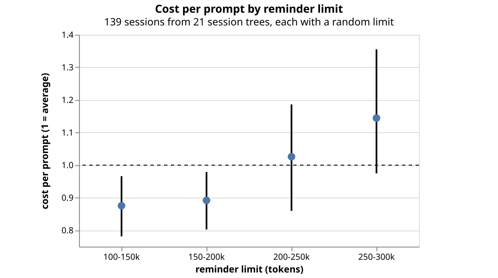
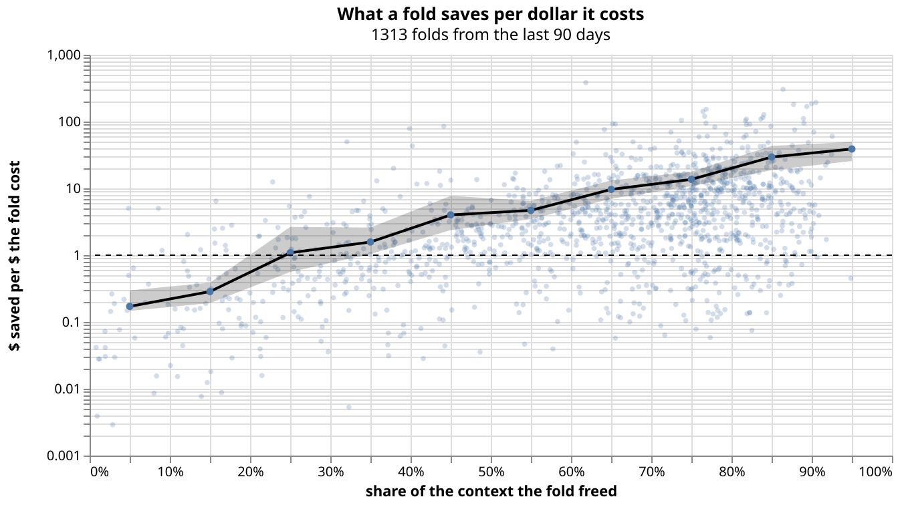

# pi-infinite-context

A [Pi](https://pi.dev/) extension for long-running sessions. The agent replaces old work in its context with short summaries. The original messages stay saved and searchable.

## Install

```bash
pi install npm:pi-infinite-context
```

Start a new session after installing.

## How it works


A **fold** groups messages under a summary. The model sees the summary instead of those messages; the originals stay in the archive. Folds can contain earlier folds, as Fold B contains Fold A above. The agent can search and read the archive without unfolding it. Pi's chat history stays unchanged.

## Tools

| Tool | What it does |
| --- | --- |
| `context_fold` | Groups consecutive messages or folds under a new summary. |
| `context_map` | Lists top-level messages, tool calls and folds, or the direct contents of one fold. A tool call and its results are one line. |
| `context_search` | Searches original messages and fold summaries using regular expressions. |
| `context_peek` | Reads one original message, tool call with its results, or fold summary by ID, with an optional line range. |

Map and search results provide the IDs to read next.

## Context reminders

From **150k tokens or 75% of the window** (whichever comes first), the extension reminds the agent to fold. The reminder states the fold rule with the current numbers, such as how much a fold should free: about 35% of the context. From 75% of the window on, it also says how much room is left. If the agent does not fold, it reminds again after another 15k tokens. Reminders never fold anything themselves.

Pi's own compaction, including `/compact`, is blocked. If the agent does not fold enough, the context can still overflow.

## Settings

Change the limits in `~/.pi/agent/infinite-context/settings.json` and restart Pi:

```json
{ "nudgeAtTokens": 150000, "nudgeAtPercent": 75 }
```

Models can have their own limits, keyed by exact `provider/id`. Missing fields fall back to the top-level values:

```json
{
  "nudgeAtTokens": 150000,
  "modelOverrides": { "llama-cpp/qwen3.8-27b": { "nudgeAtTokens": 60000 } }
}
```

`nudgeAtTokens` can also be a range like `[100000, 300000]`. Each session then gets a random limit from it. Sessions record their limits, so [context-efficiency](https://github.com/fdietze/context-efficiency) can compare them.

## Why these defaults

The charts come from the author's sessions with Claude and GPT models. They measure cost, not the quality of the agent's work.

### Remind at 150k



Each session got a random limit between 100k and 300k tokens. Each dot shows what the sessions in that range cost per prompt, where 1 is the average; the line around it shows the uncertainty. Below 200k, sessions cost about 10% less. At 250–300k, they cost about 15% more, probably because a cache miss after a pause costs more when the context is big. The data is still small, but 150k sits in the cheaper range.

### Free about 35% per fold

Providers cache the start of a prompt, and cached tokens cost about a tenth. A fold changes the prompt, so the next request is mostly uncached. In total, a fold costs about ten cached reads of the whole context. After that, every request is cheaper.



Each dot is one fold: how much of the context it freed, and how many dollars it saved per dollar it cost. Folds that free less than 20% lose money. From 30%, they pay off on average; at 70–80%, they return about 14×. The map and the summary take about 5% of the context, so the reminder asks for 35%.
