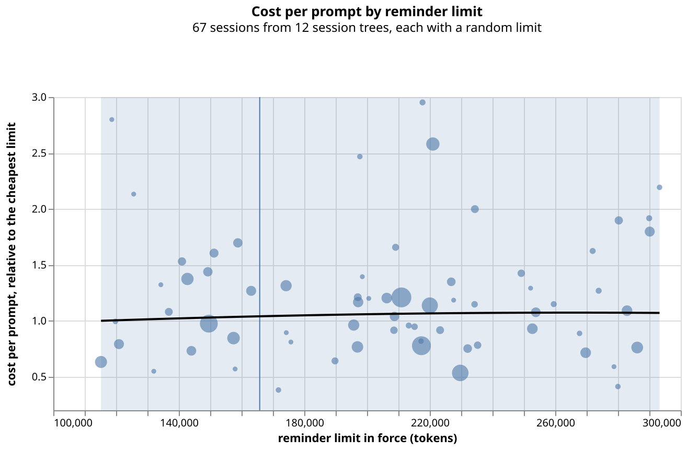
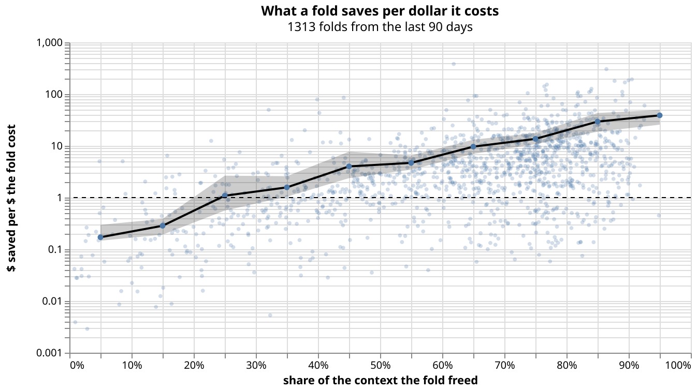

# pi-infinite-context

A [Pi](https://pi.dev/) extension for long-running sessions. The agent replaces old work in its context with short summaries. The original messages stay saved and searchable.

## Install

```bash
pi install npm:pi-infinite-context
```

Start a new session after installing.

## How it works


A **fold** groups messages under a summary. The model sees the summary instead of those messages; the originals stay in the archive. Folds can contain earlier folds, as Fold B contains Fold A above. The agent can search and read the archive without unfolding it. Pi's chat history stays unchanged.

## Tools

| Tool | What it does |
| --- | --- |
| `context_fold` | Groups consecutive messages or folds under a new summary. |
| `context_map` | Lists top-level messages and folds, or the direct contents of one fold. |
| `context_search` | Searches original messages and fold summaries using regular expressions. |
| `context_peek` | Reads one original message or fold summary by ID, with an optional line range. |

Map and search results provide the IDs to read next.

## Context reminders

From **150k tokens or 75% of the window** (whichever comes first), the extension reminds the agent to fold while it works with tools. The reminder says how many tokens a fold should free: about 30% of the context ([why](#when-a-fold-pays-off)). If the agent does not fold, it reminds again after another 15k tokens. In practice it folds at the first reminder 77% of the time. Reminders never fold anything themselves.



Why 150k: in this experiment, each session got a random limit between 100k and 300k tokens. Each dot is one session, and bigger dots have more prompts. The line is the trend, and the shaded area is where the cheapest limit may lie. So far, no limit in this range is clearly cheaper: the trend is almost flat, but 12 session trees are too few to tell the limits apart. 150k keeps the context small without costing more in this data.

Change the limits in `~/.pi/agent/infinite-context/settings.json` and restart Pi:

```json
{ "nudgeAtTokens": 150000, "nudgeAtPercent": 75 }
```

`nudgeAtTokens` can also be a range like `[100000, 300000]`. Each session then draws its own limit, which is how the experiment above works. Sessions record their limits and reminders, so tools like [context-efficiency](https://github.com/fdietze/context-efficiency) can analyze them.

Pi's own compaction, including `/compact`, is blocked. If the agent does not fold enough, the context can still overflow.

If saved folds no longer match the session, the extension stops the next request and says why. Sending the whole history unfolded would cost several times more and could overflow the window. Send another message to continue unfolded, or hand the work over to a new session. Reloading tries the folds again.

## When a fold pays off

Providers cache the start of a prompt, and cached tokens cost about a tenth of uncached ones. A fold changes the prompt, so the next request is mostly uncached. Altogether, a fold costs about ten cached reads of the whole context. After that, every request reads fewer tokens. So a fold pays off when (share freed) × (requests until the next fold) is more than about 10.



Each dot is one fold. The further right, the more of the context it freed. The higher, the more dollars it saved per dollar it cost. The line shows all folds together, and above the dashed line a fold paid off. Folds that free less than 20% lose money. From 30%, folds pay off on average, because a few dozen requests usually follow. At 70–80%, they return about 14×. So the reminder asks for about 30%.

Both charts use the author's sessions with Claude and GPT models: the last 90 days for folds, and since 2026-10-26 for the limit experiment. They measure cost only, not the quality of the agent's work. They come from [context-efficiency](https://github.com/fdietze/context-efficiency).
